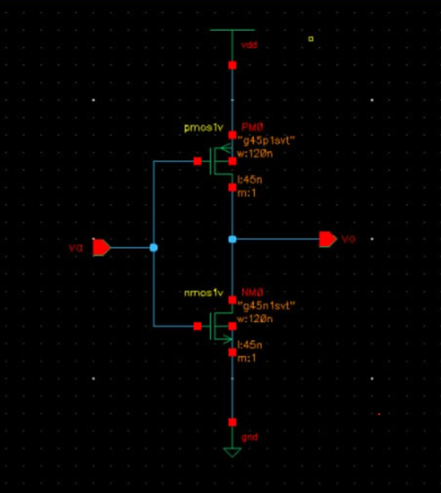
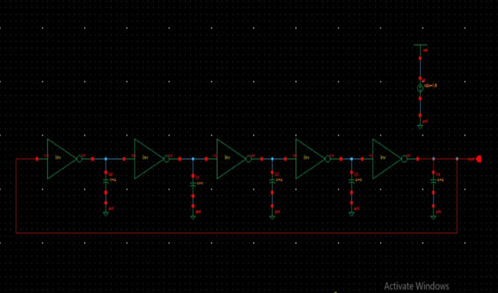
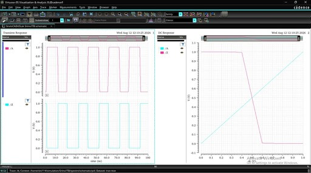
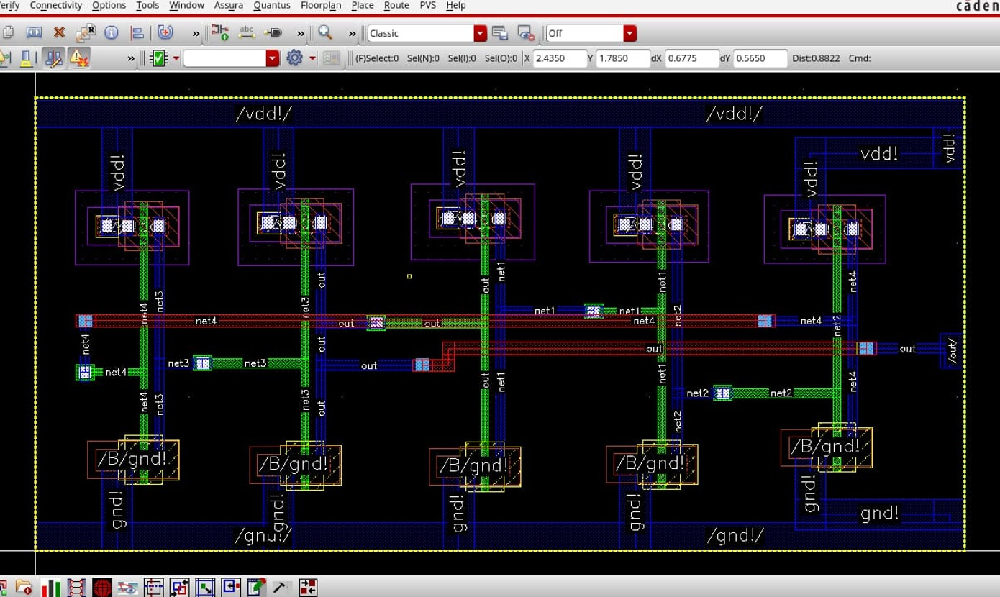
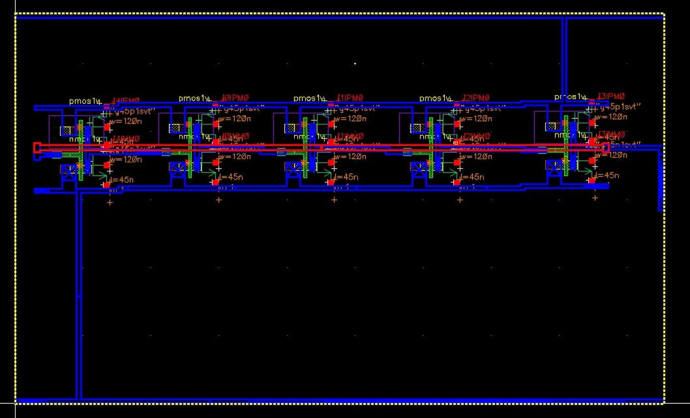
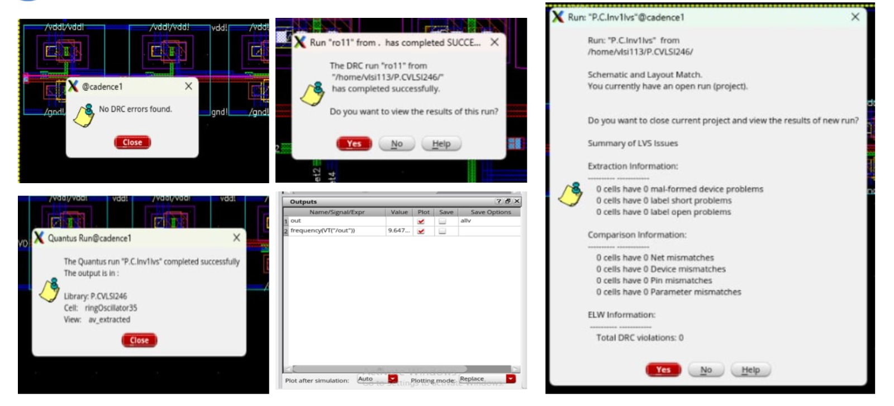

# 5-Stage CMOS Ring Oscillator (45nm GPDK)

A collaborative capstone project for **VLSI Design (241EC011)** at **Aditya University**, focusing on designing, simulating, analyzing, and laying out a single-ended 5-stage static CMOS inverter-based ring oscillator in **45 nm GPDK CMOS technology** using **Cadence Virtuoso** and **Spectre**.

> **Team & Role Note:** This was a collaborative team project. My primary contributions were **circuit theory, performance analysis, and complete technical report documentation**.

---

## Project Overview

A CMOS Ring Oscillator (RO) generates on-chip clock signals without requiring bulky inductors or external crystal components by cascading an odd number ($N$) of inverter stages in a closed negative-feedback loop. Under a total loop delay of $2N \cdot t_p$, self-sustained oscillations occur at:

$$f_{\text{osc}} = \frac{1}{2N \cdot t_p}$$

### Key Implementation Specifications

| Parameter / Feature | Value / Setting |
| :--- | :--- |
| **Technology Node** | 45 nm GPDK CMOS |
| **MOSFET Models** | `g45p1svt` (PMOS) & `g45n1svt` (NMOS) |
| **Transistor Dimensions** | $W_p = 120\text{ nm},\; L_p = 45\text{ nm}$ and $W_n = 120\text{ nm},\; L_n = 45\text{ nm}$ |
| **Number of Stages ($N$)** | 5 Inverter Stages |
| **Supply Voltage ($V_{\text{DD}}$)** | 1.8 V / 1.0 V |
| **Swept Parameter** | Node Load Capacitance ($C_L$) |
| **EDA Tool Suite** | Cadence Virtuoso Schematic & Layout Suite, Spectre, Quantus / Assura |

---

## Circuit Architecture & Schematics

The design starts with a static CMOS inverter unit cell ($W/L = 120\text{ nm}/45\text{ nm}$ for both PMOS and NMOS) and scales recursively into a 5-stage closed feedback loop with load capacitors connected at intermediate nodes.

| Single-Stage CMOS Inverter Schematic | 5-Stage Ring Oscillator Top-Level Schematic |
| :---: | :---: |
|  |  |

---

## Simulation & Functional Verification

### 1. CMOS Inverter Transient & DC Response
The unit CMOS inverter was verified in Cadence Virtuoso Visualization & Analysis XL using Spectre with a 0 V to 1.0 V input pulse and DC sweep, showing full rail-to-rail swing and switching near $0.5\text{ V}$.

| Measured / Observed Item | Value Visible in Waveform | Interpretation / Significance |
| :--- | :--- | :--- |
| **Logic HIGH Level ($V_{\text{OH}}$)** | $\approx 1.0\text{ V}$ | Full rail-to-rail swing matching $V_{\text{DD}} = 1.0\text{ V}$ |
| **Logic LOW Level ($V_{\text{OL}}$)** | $\approx 0\text{ V}$ | Solid ground reference with zero static degradation |
| **Switching Threshold ($V_M$)** | $\approx 0.5\text{ V}$ | Symmetric switching behavior between PMOS and NMOS |
| **Transient Period ($T$)** | $20.0\text{ ns}$ | High-speed pulse response across continuous cycles |

---

## Performance Analysis Across Load Capacitance

Transient simulations of the 5-stage ring oscillator ($N = 5$) were recorded across load capacitance values of **5 fF**, **500 fF**, and **1 pF** ($V_{\text{DD}} = 1.8\text{ V}$, $T = 27^\circ\text{C}$), using $t_p = \frac{T}{2N}$:

| S. No. | Load Capacitance ($C_L$) | Frequency ($f_{\text{osc}}$) | Time Period ($T = 1/f$) | Time Period ($T$ in ps) | Stage Propagation Delay ($t_p$) | Power-Delay Product (PDP) |
| :---: | :---: | :---: | :---: | :---: | :---: | :---: |
| **1** | 5 fF | 1.786 GHz | $5.599 \times 10^{-10}\text{ s}$ | $559.91\text{ ps}$ | $55.99\text{ ps}$ | $1.086\text{ fJ}$ |
| **2** | 500 fF | 19.28 GHz | $5.187 \times 10^{-11}\text{ s}$ | $51.87\text{ ps}$ | $5.19\text{ ps}$ | $0.101\text{ fJ}$ |
| **3** | 1 pF | 9.647 GHz | $1.037 \times 10^{-10}\text{ s}$ | $103.66\text{ ps}$ | $10.37\text{ ps}$ | $0.201\text{ fJ}$ |

### Power Dissipation Summary
Average transient power dissipation measured on the `:pwr` signal across execution intervals:
* **Average Power Reading 1:** $\approx 19.40\;\mu\text{W}$ ($19.40 \times 10^{-6}\text{ W}$)
* **Average Power Reading 2:** $\approx 19.46\;\mu\text{W}$ ($19.46 \times 10^{-6}\text{ W}$)

---

## Physical Layout, PEX & Verification

The 5-stage physical layout aligns five inverter stages horizontally with shared horizontal `/vdd!/` and `/gnd!/` rails and closed feedback routing in 45 nm GPDK, followed by DRC, LVS, and Parasitic Extraction (PEX).

| 5-Stage Physical Layout | Post-Layout PEX Extracted View |
| :---: | :---: |
|  |  |

### DRC, LVS & Quantus Verification

| Physical Design Item | Implementation Status | Remarks / Verification |
| :--- | :--- | :--- |
| **5-Stage Inverter Cell Array** | Completed | 5 modular inverter stages aligned horizontally |
| **Transistor Sizing** | Completed | $W/L = 120\text{ nm} / 45\text{ nm}$ for both PMOS & NMOS |
| **Power/Ground Rails Integration** | Completed | Shared `/vdd!/` and `/gnd!/` horizontal rails |
| **Closed Feedback Routing** | Completed | Feedback path routed from Stage 5 output to Stage 1 input |
| **DRC Verification** | Passed | 100% technology rule compliance (0 errors) |
| **LVS Verification** | Passed | Schematic vs. Layout netlist matches fully |
| **Parasitic Extraction (PEX)** | Completed | $R+C$ parasitic view generated (`gpdk045`) |

---

## Repository Files

* `README.md` — Project summary, tables, analysis, and embedded design visuals
* `CMOS Ring oscillator report.docx` — Full cornerstone project report
* `inverter_schematic.png` — Single-stage CMOS inverter schematic
* `ring_oscillator_schematic.jpg` — 5-stage CMOS ring oscillator schematic
* `inverter_waveform.jpeg` — CMOS inverter transient and DC VTC response
* `physical_layout.jpeg` — 5-stage physical layout in 45 nm GPDK
* `pex_view.jpeg` — Post-layout parasitic extracted (PEX) view
* `verification_summary.jpeg` — DRC, LVS, and Quantus verification summary[cite: 11]
